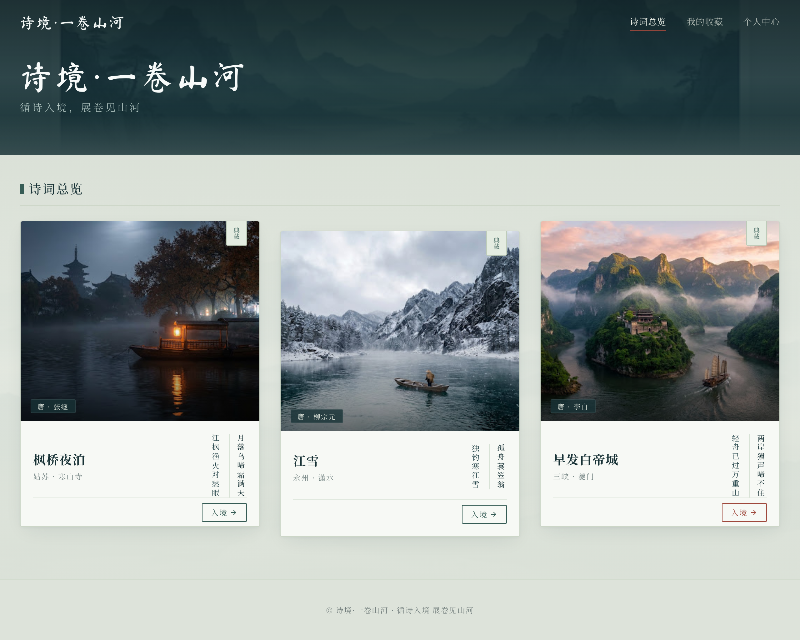

# S01 首页修订稿 · v02 · 待用户审批

- 实际来源：Stitch `edit_screens`，2026-10-01。
- 画板：`575c91f93ac94b4eaf7a54e987a3d51a`。
- 原图：**2560×2048 PNG**；未手工重绘或替换其内部图片。
- [实际修订请求](S01-home-desktop.request.json) / [来源与文件校验清单](../stitch-manifest.json)。
- [Stitch 私有项目](https://stitch.withgoogle.com/projects/11329297360365535924)。

## 本轮变化

卡片中的嵌套网页和大文字框已去除，改为更大面积的写实景观；删除原稿中的虚构年份、分类和页脚链接。保留暗色题头、三首卡片、竖排诗句与顶部三个入口。

## 审批时仍需注意

- 下方背景在导出的整页图中仍偏平，山水和水光没有达到 brief 预期的可辨识度；不能因工具文字声称已加入就视为达标。
- 顶部水流、卡片漂浮仍只是设计意图，静图无法证明动态。
- 行书字形、导航字体、收藏“典藏”文案与状态仍需用户确认；字体许可未最终核验。
- 建筑与舟是 AI 意象参考，不是历史建筑复原或已完成的 Blender 资产。

**等待用户对首页方向的反馈，不进入前端实现。** 其余页面和转场分镜未生成。
