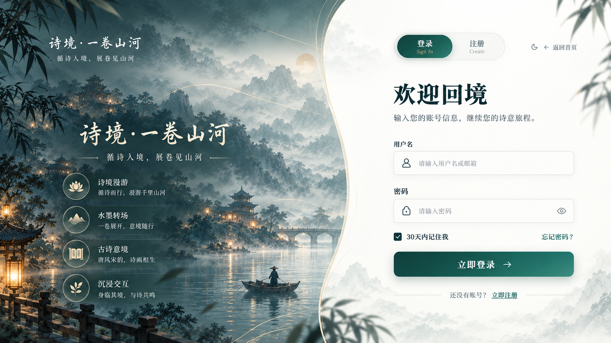
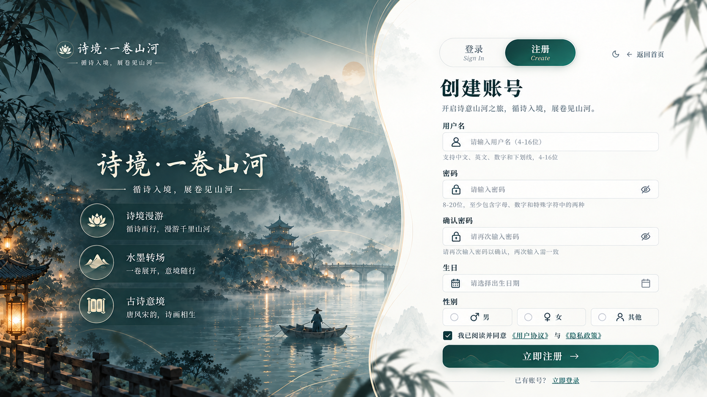

# v10 · 登录与注册用户新图

2026-10-02，用户明确指定本次两张附件替换文档中的登录、注册图，并按新图修改页面。S11/S12 的当前基准改为本目录；v07 账号原图仅保留历史，S06 个人中心和 S13 幕布入口继续沿用 v07。

| ID | 原图 | 用途 |
|---|---|---|
| S11 | [登录](references/S11-login-user.png) | 左侧四项体验、右侧曲线留白、欢迎回境、顶部双语切换与返回首页 |
| S12 | [注册](references/S12-register-user.png) | 左侧三项体验、创建账号、紧凑注册字段、顶部双语切换与返回首页 |

两图均为 1672×941，附件原样复制，未重绘、裁切或缩放，SHA-256 见 [manifest](manifest.json)。作者、原制作工具与发布许可未提供，不登记为本轮生成图。

实施契约：左山水、右曲线白面连续铺满屏幕；不使用旧侧幕或带双框的绢纸表单卡。表单、文案、导航与按钮使用 DOM；仅图标取原图无文字局部，背景由原图去 UI 后另存运行素材。字体遵循新增 [字体规范](../../../字体规范.md)：品牌行书、标题/主按钮宋体、诗意文案文楷、导航/表单黑体。登录与注册在桌面一屏显示，输入选中时无外框和阴影，仅显示光标，按钮与链接保留键盘焦点。协议需用户主动选择，当前正文为开发测试说明，正式发布协议待补。Spring Boot认证首版已接通；记忆选项同时启用30天持久登录和本机用户名记忆，密码不进入本机存储；服务失败时不伪造成功。
