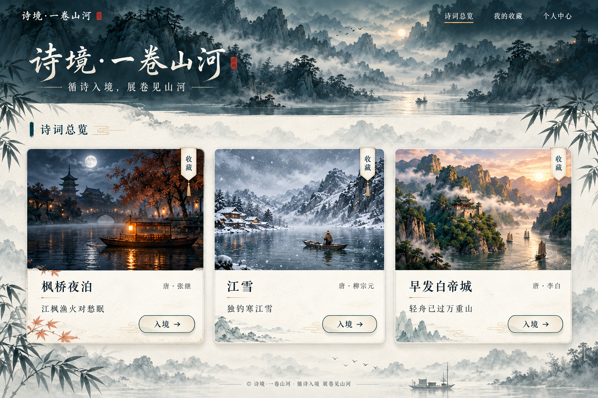

# 桌面网页 UI 设计与审批入口

沿用用户认可的青黛山水、浅绢纸和写实诗境风格。**最新范围仅桌面网页**；此前移动稿保留历史文件，不纳入本轮审批或实施。2026-10-01 用户已授权核对文档后开始代码还原，进入 [R1 实施计划](../plans/R1-UI还原/plan.md)。本页的逐项推荐原图组成当前视觉基准，不能简单采用版本号最大的整个目录。

## 首页卡片修订

**[主页用户指定稿 v09](2026-10-01-v3/v09/screens/S01-home-desktop-user.png)**

用户最新要求用本次第一张原图替换主页、第二张原图替换收藏页，两图原样保存为 [v09](2026-10-01-v3/v09/README.md)。主页三卡上下齐平，全宽山水题头与纸面山影、竹叶、卡片装饰以原图为准；此选图取代此前 v08 云雾减法提案。没有重新生成或修改图片。

旧 [v06 浏览器实测](2026-10-01-v3/v06/card-measurements.json) 仅验证旧源稿，不适用于用户原图；v09 是用户指定视觉基准，后续实施仍需精确 CSS 测量与真实浏览器验收。

## 登录与注册修订

2026-10-02 用户指定两张新图替换原账号稿，已原样保存于 [v10](2026-10-01-v3/v10/README.md)。当前登录与注册使用左侧山水、右侧曲线留白、顶部双语切换和返回首页，并在桌面一屏展示。字体以新增 [字体规范](../字体规范.md) 为准：品牌行书、标题宋体、诗意文案文楷、功能信息黑体。所有输入控件选中时无外框，仅显示光标；按钮和链接保留键盘焦点。旧 v07 登录与注册不再作为实施基准。

## 桌面页面与状态稿

| ID | 推荐原图 | 重点 |
|---|---|---|
| S01 | [主页用户原图 v09](2026-10-01-v3/v09/screens/S01-home-desktop-user.png) | 用户指定替代 v08，原样保存，作为还原基准 |
| S02 | [枫桥夜泊 v04](2026-10-01-v3/v04/screens/S02-fengqiao-desktop.png) | 夜江、渔火、四列完整诗文 |
| S03 | [江雪 v04](2026-10-01-v3/v04/screens/S03-jiangxue-desktop.png) | 寒江、孤舟、广域碎雪 |
| S04 | [早发白帝城 v07](2026-10-01-v3/v07/screens/S04-baidicheng-desktop.png) | 晨峡、轻舟、四列七字诗等间距，参照枫桥 |
| S05 | [收藏页用户原图 v09](2026-10-01-v3/v09/screens/S05-favorites-desktop-user.png) | 用户指定替代 v05；已收藏、取消收藏与入境 |
| S06 | [个人中心用户原图](2026-10-01-v3/v07/references/S06-profile-user.png) | 替代旧 Stitch 稿；左侧资料，右侧收藏/浏览/偏好/设置 |
| S11 | [登录用户原图 v10](2026-10-01-v3/v10/references/S11-login-user.png) | 山水与曲线白面、欢迎回境、四项体验 |
| S12 | [注册用户原图 v10](2026-10-01-v3/v10/references/S12-register-user.png) | 创建账号、紧凑表单、三项体验 |
| S13 | [幕布入口用户原图](2026-10-01-v3/v07/references/S13-curtain-entry-user.png) | 宣传语与登录/注册按钮；点击拉幕揭示目标页 |
| S10 | [关键状态板 v03](2026-10-01-v3/v03/screens/S10-states-desktop.png) | 空收藏、入境失败、头像错误/裁切、存储失败、减少动态 |

## 转场分镜

| ID | 原图 | 方向 |
|---|---|---|
| T01 | [中央火烧校验预览](2026-10-01-v3/v06/previews/T01-fire-reveal.preview.png) · [Stitch 原稿](2026-10-01-v3/v05/transitions/T01-fire-reveal.png) | 中央开口、径向外扩、火缘退出 |
| T02 | [右上碎雪 v04](2026-10-01-v3/v04/transitions/T02-snow-reveal.png) | 右上向左下广域覆幕，再露出江雪 |
| T03 | [云水入峡 v04](2026-10-01-v3/v04/transitions/T03-cloud-reveal.png) | 青灰云水遮幕、晨峡显现 |
| T04 | [翻书返回校验预览](2026-10-01-v3/v06/previews/T04-page-return.preview.png) · [Stitch 原稿](2026-10-01-v3/v05/transitions/T04-page-return.png) | 诗境纸页向右翻起，露出总览 |
| T05 | [登录/注册拉幕规范](2026-10-01-v3/v07/curtain-transition.md) · [R1 实现报告](../plans/R1-UI还原/report.md) | DOM 拉幕首版已实现，原规范的完整布面与三维衔接仍需后续验收 |

火烧/翻页的 Stitch 封面修订连接失败，另附 [源稿资源校验预览](2026-10-01-v3/v06/previews/README.md)，不冒充新 Stitch 出图。分镜缩图用于审阅方向，正式字体、诗句列序和构图以 S01–S04 页面稿为准；剩余细节见 [视觉自检](2026-10-01-v3/visual-review.md)。静态稿不能证明动画或实时三维已实现。

## 审批与追溯

- [逐稿审批表](2026-10-01-v3/review.md)：用户已认可原 Desktop 风格，新页面与修订稿仍待逐稿反馈。
- [Stitch 私有项目](https://stitch.withgoogle.com/projects/11329297360365535924)
- [实际调用、异常与输出记录](2026-10-01-v3/generation-log.md)
- [首页尺寸与排版自检](2026-10-01-v3/S01-self-review.md)
- [设计输入](2026-10-01-v3/brief.md) · [精确提示词说明](2026-10-01-v3/prompts.md) · [参考来源](2026-10-01-v3/references.md)

仍按 `docs/design/2026-10-01-v3/vNN/` 逐版保存。Stitch 版本保留页面、分镜、原始 HTML、素材与 stitch-manifest；v07 保存 image_gen 修订 PNG、requests 提示词、references 用户原附件及 manifest。逐项区分来源，不覆盖旧版，不虚构画板或会话标识。

## 目录与实施映射

`v01`–`v08` 保留生成历史；`v09` 替换 S01/S05，`v10` 替换 S11/S12。`screens/` 是审阅图，`sources/` 是历史 Stitch HTML，`assets/` 是概念素材，`references/` 是用户原图，`requests/` 与 manifest 用于追溯。历史 HTML 不直接作为应用入口。

| 当前稿 | 应用职责 | 目录 |
|---|---|---|
| S01/S05 v09 | 总览与收藏，复用诗卡 | `frontend/src/ui/pages/`、`frontend/src/ui/components/` |
| S02/S03 v04、S04 v07 | 诗文展示 UI；先静态视觉预览，实时场景在 R2/R3 制作 | `frontend/src/ui/pages/`、`frontend/src/content/` |
| S06 v07 用户原图 | 资料、真实收藏与浏览、偏好设置 | `frontend/src/ui/pages/`、`frontend/src/stores/` |
| S11/S12 v10 用户原图 | 登录/注册表单、双语切换与返回首页 | `frontend/src/ui/pages/`、`frontend/src/ui/styles/account.css` |
| S13 v07 用户原图 | 幕布入口与拉幕 | `frontend/src/ui/pages/`、`frontend/src/transition/` |

R1 素材仅用于本地还原预览，来源与发布限制见 CREDITS，不将整张设计稿铺成可点击网页。文字、表单、导航和收藏均用 DOM 实现；画面区域可引用原图中的无文字局部。正式发布前替换或核实素材许可与字体。静态 UI、拉幕与真实三维诗境分别验收。

2026-10-02 目录整理：原稿继续在 docs/design，实际运行副本位于 frontend/src/assets/ui 并登记 sources.json，不再从源码直接导入 docs。当前认证与分离任务见 [R1A](../plans/R1A-认证服务/plan.md)。
