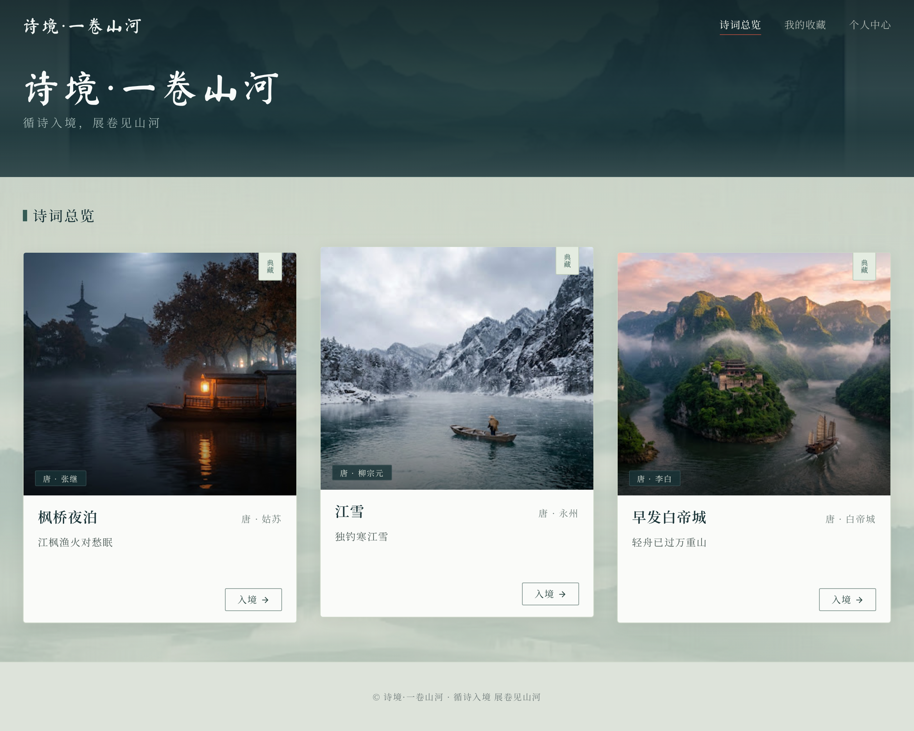

# 桌面网页 UI 设计与审批入口

沿用用户认可的青黛山水、浅绢纸和写实诗境风格，以 Stitch MCP 完成续稿。**最新范围仅桌面网页**；此前移动稿保留历史文件，不纳入本轮审批或实施。

## 首页卡片修订

**[首页推荐稿 v06 · 完整原图 2560×2048](2026-10-01-v3/v06/screens/S01-home-desktop.png)**

三卡统一外框、封面和内容区，中央卡仅上移 8px，不缩放；卡片代表句改为横排，诗境详情仍为竖排。下部保留可见山水层次。

[浏览器实测](2026-10-01-v3/v06/card-measurements.json)：1440px 窗口下三卡约 405.3×520px，1024px 窗口下约 298.7×520px；封面均高 340px。尺寸一致，诗句与入境按钮互不重叠。

## 桌面页面与状态稿

| ID | 推荐原图 | 重点 |
|---|---|---|
| S01 | [诗词总览 v06](2026-10-01-v3/v06/screens/S01-home-desktop.png) | 双分区、等尺寸卡片、首页无返回 |
| S02 | [枫桥夜泊 v04](2026-10-01-v3/v04/screens/S02-fengqiao-desktop.png) | 夜江、渔火、四列完整诗文 |
| S03 | [江雪 v04](2026-10-01-v3/v04/screens/S03-jiangxue-desktop.png) | 寒江、孤舟、广域碎雪 |
| S04 | [早发白帝城 v04](2026-10-01-v3/v04/screens/S04-baidicheng-desktop.png) | 晨峡、轻舟、诗题与作者分开 |
| S05 | [我的收藏 v05](2026-10-01-v3/v05/screens/S05-favorites-desktop.png) | 同规格诗卡、取消收藏、入境 |
| S06 | [个人中心 v04](2026-10-01-v3/v04/screens/S06-profile-desktop.png) | 本地头像、姓名/性别、保存/取消、收藏 |
| S10 | [关键状态板 v03](2026-10-01-v3/v03/screens/S10-states-desktop.png) | 空收藏、入境失败、头像错误/裁切、存储失败、减少动态 |

## 转场分镜

| ID | 原图 | 方向 |
|---|---|---|
| T01 | [中央火烧校验预览](2026-10-01-v3/v06/previews/T01-fire-reveal.preview.png) · [Stitch 原稿](2026-10-01-v3/v05/transitions/T01-fire-reveal.png) | 中央开口、径向外扩、火缘退出 |
| T02 | [右上碎雪 v04](2026-10-01-v3/v04/transitions/T02-snow-reveal.png) | 右上向左下广域覆幕，再露出江雪 |
| T03 | [云水入峡 v04](2026-10-01-v3/v04/transitions/T03-cloud-reveal.png) | 青灰云水遮幕、晨峡显现 |
| T04 | [翻书返回校验预览](2026-10-01-v3/v06/previews/T04-page-return.preview.png) · [Stitch 原稿](2026-10-01-v3/v05/transitions/T04-page-return.png) | 诗境纸页向右翻起，露出总览 |

火烧/翻页的 Stitch 封面修订连接失败，另附 [源稿资源校验预览](2026-10-01-v3/v06/previews/README.md)，不冒充新 Stitch 出图。分镜缩图用于审阅方向，正式字体、诗句列序和构图以 S01–S04 页面稿为准；剩余细节见 [视觉自检](2026-10-01-v3/visual-review.md)。静态稿不能证明动画或实时三维已实现。

## 审批与追溯

- [逐稿审批表](2026-10-01-v3/review.md)：用户已认可原 Desktop 风格，新页面与修订稿仍待逐稿反馈。
- [Stitch 私有项目](https://stitch.withgoogle.com/projects/11329297360365535924)
- [实际调用、异常与输出记录](2026-10-01-v3/generation-log.md)
- [首页尺寸与排版自检](2026-10-01-v3/S01-self-review.md)
- [设计输入](2026-10-01-v3/brief.md) · [精确提示词说明](2026-10-01-v3/prompts.md) · [参考来源](2026-10-01-v3/references.md)

仍按 `docs/design/2026-10-01-v3/vNN/` 逐版保存：`screens/` 页面 PNG 与实际请求，`transitions/` 分镜 PNG 与实际请求，`sources/` 原始 Stitch HTML，`assets/` 随稿概念素材，以及 `stitch-manifest.json`。原图不人工重绘、不覆盖旧版；manifest 登记实际画板、会话、尺寸和 SHA-256，失败请求另记。

应用代码尚未因这些稿件改动。用户逐稿审批后才进入前端、Blender 与 Three.js 实施，设计图片不直接搬入 public。
